<div align="center">

# PacketProof

**Prove every network change before it merges.**

A two-site company network, written as code. Every pull request rebuilds the whole network on a
free GitHub runner and must pass real traffic tests before it can merge. Every night, those tests
are graded against 30 deliberately broken changes, and whatever they miss is published.

[](https://github.com/aymen-nasri/packetproof/actions/workflows/pr-gate.yml)
[](https://github.com/aymen-nasri/packetproof/actions/workflows/gate3.yml)
[](https://github.com/aymen-nasri/packetproof/releases/latest)
[](LICENSE)

[Live scorecard](https://aymen-nasri.github.io/packetproof/) ·
[Results](#results) ·
[How it works](#how-it-works) ·
[Quick start](#quick-start) ·
[Documentation](#documentation)

</div>

<p align="center">
  <picture>
    <source media="(prefers-color-scheme: dark)" srcset="docs/images/overview-dark.svg">
    
  </picture>
</p>

## Results

Measured on the code of [v1.1.0](https://github.com/aymen-nasri/packetproof/releases/tag/v1.1.0).
Every number links to the run that produced it.

| | Result | Evidence |
|---|---|---|
| **Planted faults caught** | **27 of 30**: 19 by static analysis (Gate 1), 8 more only by the live copy (Gate 2) | Three Gate 3 runs with identical verdicts: [42902266017](https://github.com/aymen-nasri/packetproof/actions/runs/42902266017), [42902610699](https://github.com/aymen-nasri/packetproof/actions/runs/42902610699), [42907526683](https://github.com/aymen-nasri/packetproof/actions/runs/42907526683) |
| **Faults that escaped** | **3**, all latent: another control or the protocol masked them, and no traffic changed | [Why, one by one](docs/limits.md#the-three-escapes-that-remain-and-why-each-changed-no-traffic) |
| **Attack paths** | **12 of 12 blocked** from a compromised DMZ host, each while its legitimate twin passed | The same runs; [scorecard.md](docs/scorecard.md) |
| **Live tests per change** | **137**, against 15 containers and 6 zone bridges | [Gate 2 on main](https://github.com/aymen-nasri/packetproof/actions/runs/42919542618) |
| **Pull-request gate** | **4.1 min** median (3.9 to 4.4) | [Timing](#timing) |
| **A change in production** | A firewall change applied in place in about **1 s**, with **0** failed requests and **0** broken TCP connections | [42836367491](https://github.com/aymen-nasri/packetproof/actions/runs/42836367491), [42838516660](https://github.com/aymen-nasri/packetproof/actions/runs/42838516660) |
| **Latest production run** | Every signature verified and a tampered bundle refused; re-applied in 0.95 s with 0 of 449 requests failed; no drift; 137 of 137 live tests after | [42902885547](https://github.com/aymen-nasri/packetproof/actions/runs/42902885547) |
| **Releases** | Rebuilt from the tag and byte-identical to main's build; signed, attested and immutable | [v1.1.0](https://github.com/aymen-nasri/packetproof/releases/tag/v1.1.0); [verify one yourself](docs/verify.md) |

The full history of every graded run is in [scorecard.md](docs/scorecard.md), and what each gate
cannot see is in [limits.md](docs/limits.md).

## How it works

The diagrams go from the general to the detailed. The network diagrams are drawn from
`network.yaml` by [`scripts/diagrams.py`](scripts/diagrams.py), and a unit test fails if they fall
out of date.

### 1. One file describes the whole network

<p align="center">
  <picture>
    <source media="(prefers-color-scheme: dark)" srcset="docs/images/source-of-truth-dark.svg">
    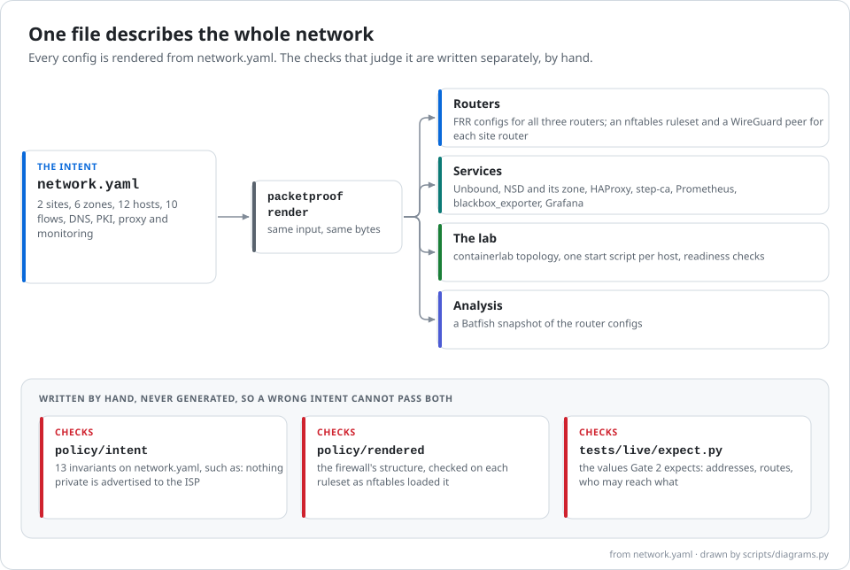
  </picture>
</p>

[`network.yaml`](network.yaml) holds the intent: two sites, six zones, twelve hosts, the complete
firewall allow list, NAT, split-horizon DNS, the certificate authority, the proxy and monitoring.
`python -m packetproof render` turns it into every router config, firewall ruleset, tunnel, DNS
zone, CA and proxy setting, the containerlab topology and a Batfish snapshot. The same input always
gives the same bytes. The rules that judge the result are written separately, by hand, so a wrong
intent cannot pass both.

### 2. The network

<p align="center">
  <picture>
    <source media="(prefers-color-scheme: dark)" srcset="docs/images/network-dark.svg">
    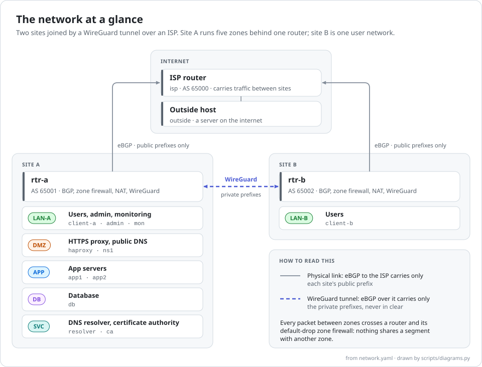
  </picture>
</p>

- **Routing.** FRR on every router. eBGP to the ISP carries only each site's public prefix; eBGP
  over the WireGuard tunnel carries only the private prefixes. Each site router filters every
  session in both directions, and refuses private space from the ISP at every prefix length.
- **Isolation.** Each zone is its own Linux bridge, and a router is the only device on more than
  one, so every packet between zones meets a firewall. Gate 2 checks that no host has an address
  outside the plan.
- **Addressing.** Private addresses inside (172.16.0.0/12), documentation ranges for the public
  side ([address plan](docs/address-plan.md)).

The same network, with every interface and address:

<p align="center">
  <picture>
    <source media="(prefers-color-scheme: dark)" srcset="docs/images/network-detail-dark.svg">
    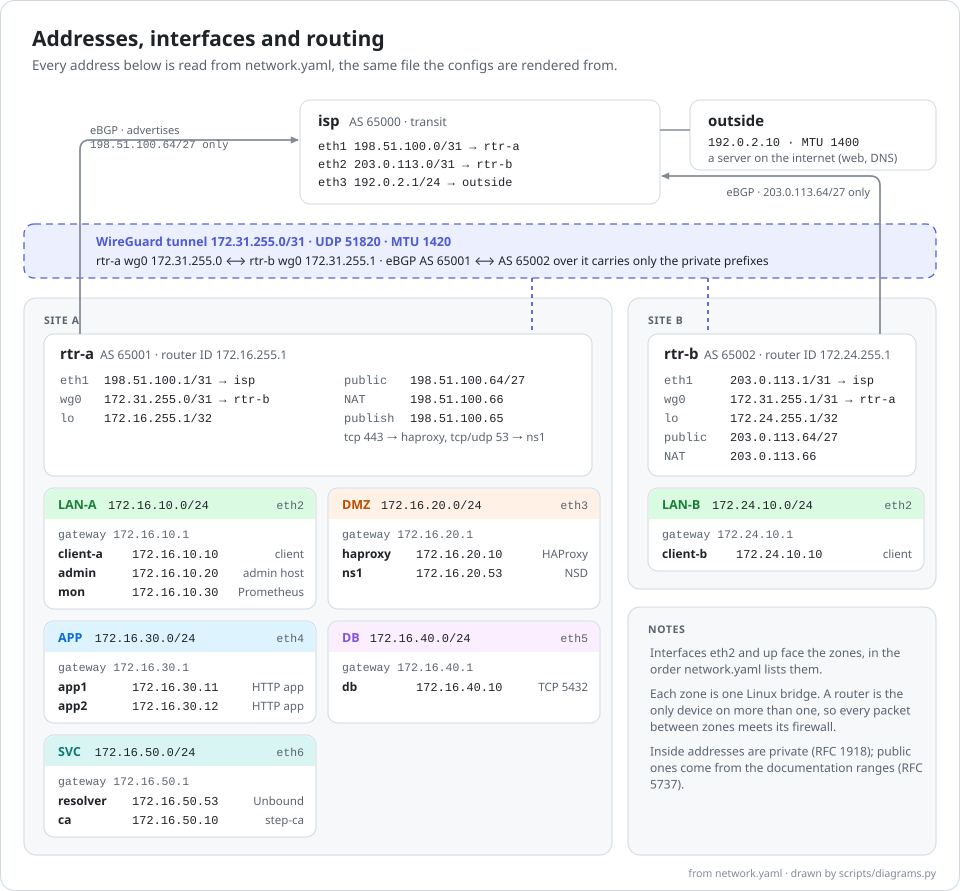
  </picture>
</p>

### 3. The zone firewall

<p align="center">
  <picture>
    <source media="(prefers-color-scheme: dark)" srcset="docs/images/firewall-dark.svg">
    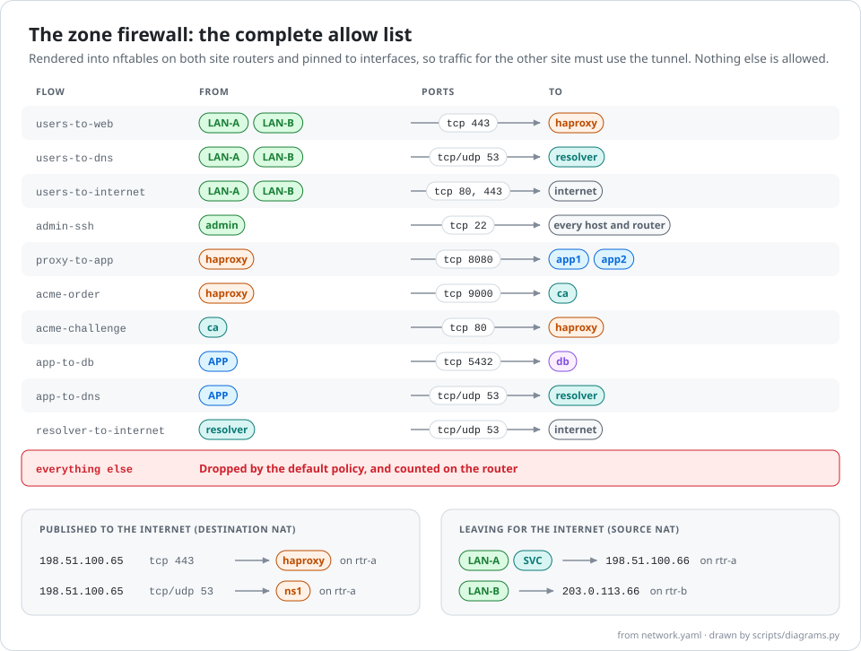
  </picture>
</p>

Both site routers run nftables. The allow list is rendered into a default-drop forward chain,
pinned to interfaces so that traffic for the other site must use the tunnel. Inside each router,
rules apply in this order:

<p align="center">
  <picture>
    <source media="(prefers-color-scheme: dark)" srcset="docs/images/packet-path-dark.svg">
    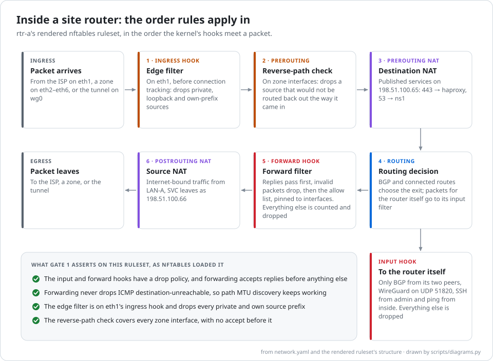
  </picture>
</p>

### 4. The services

<p align="center">
  <picture>
    <source media="(prefers-color-scheme: dark)" srcset="docs/images/services-dark.svg">
    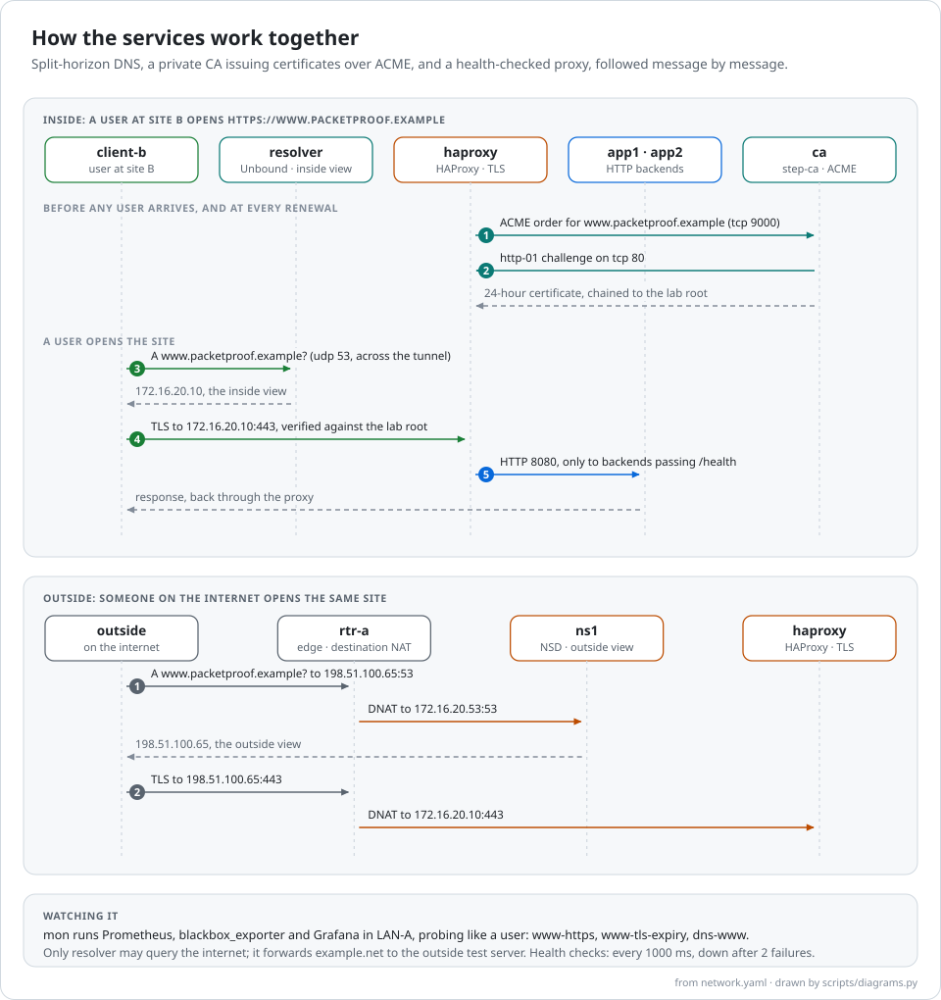
  </picture>
</p>

- **DNS, split horizon.** Unbound answers inside clients with inside addresses; NSD answers the
  internet with public ones, published through destination NAT. Only the resolver may query the
  internet.
- **A private CA.** step-ca issues certificates of at most 24 hours over ACME, and clients verify
  them against the lab's own root.
- **A health-checked proxy.** HAProxy terminates TLS and spreads requests over two backends, routing
  around one that fails its health check.
- **Monitoring.** Prometheus, blackbox_exporter and Grafana probe the site as a user would: HTTPS,
  certificate expiry and the DNS answer.

### 5. How a change is proved

<p align="center">
  <picture>
    <source media="(prefers-color-scheme: dark)" srcset="docs/images/gates-dark.svg">
    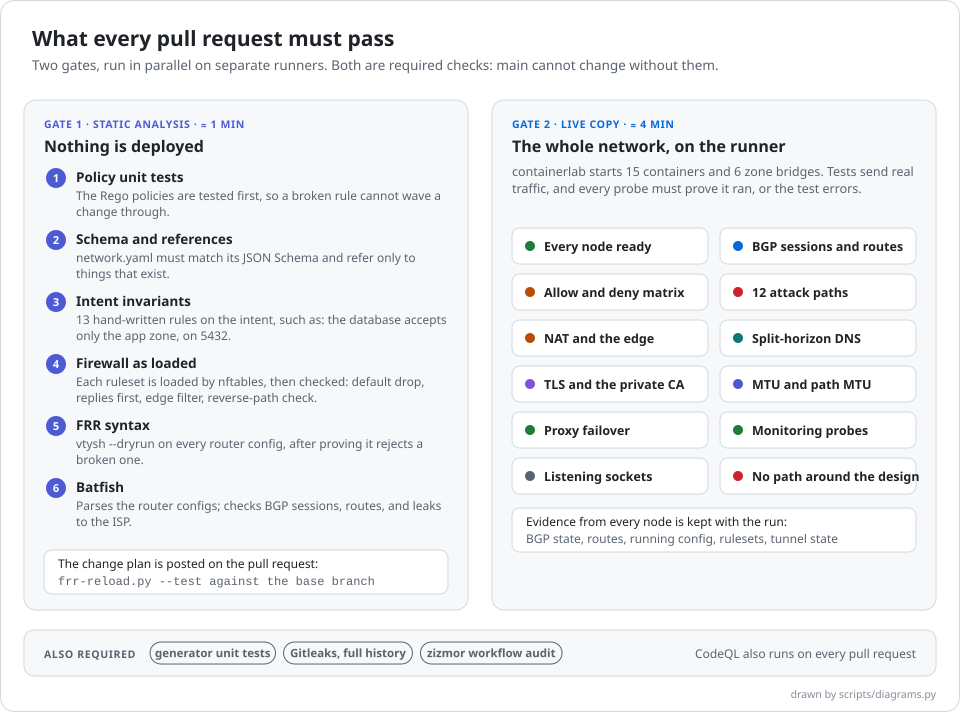
  </picture>
</p>

Gate 1 analyses the rendered configs without deploying anything; Gate 2 starts the whole network
on its own runner and tests it with real connections. The two run in parallel, and both are
required checks, along with the generator's unit tests, Gitleaks and
zizmor: `main` cannot change without them. Each pull request also gets a change plan, the
`frr-reload.py --test` diff against the base branch, posted as a comment.

#### Timing

Over the 5 pull-request gate runs with v1.1.0's tests
([42899324990](https://github.com/aymen-nasri/packetproof/actions/runs/42899324990) to
[42902138355](https://github.com/aymen-nasri/packetproof/actions/runs/42902138355)), the medians
are 1.0 min for Gate 1, 4.0 min for Gate 2, and 4.1 min for the whole gate (3.9 to 4.4). A Gate 3
run takes about 32 minutes ([42902266017](https://github.com/aymen-nasri/packetproof/actions/runs/42902266017)):
it ends with its slowest fault, which drops all return traffic, so every probe in that job waits out
its timeout.

### 6. Grading the gates

<p align="center">
  <picture>
    <source media="(prefers-color-scheme: dark)" srcset="docs/images/grading-dark.svg">
    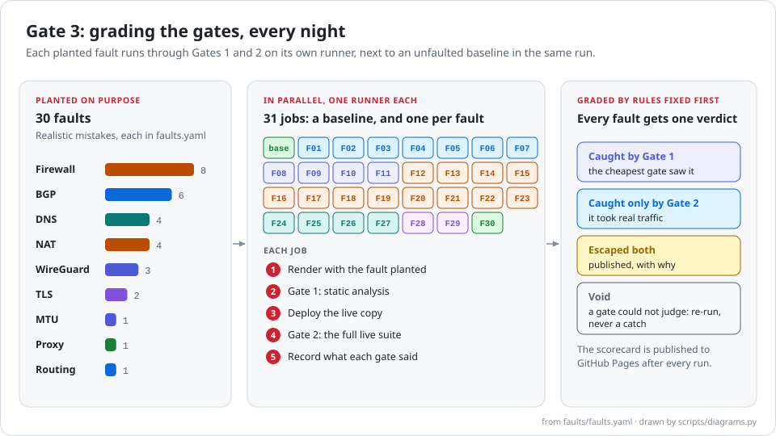
  </picture>
</p>

A gate that never fails proves nothing, so every night Gate 3 plants 30 realistic mistakes
([faults.yaml](faults/faults.yaml)), one per runner, and records which gate caught each. The
rules, the faults and the predictions were committed in [method.md](docs/method.md) before any
test existed. The segmentation is also attacked directly:

<p align="center">
  <picture>
    <source media="(prefers-color-scheme: dark)" srcset="docs/images/attack-paths-dark.svg">
    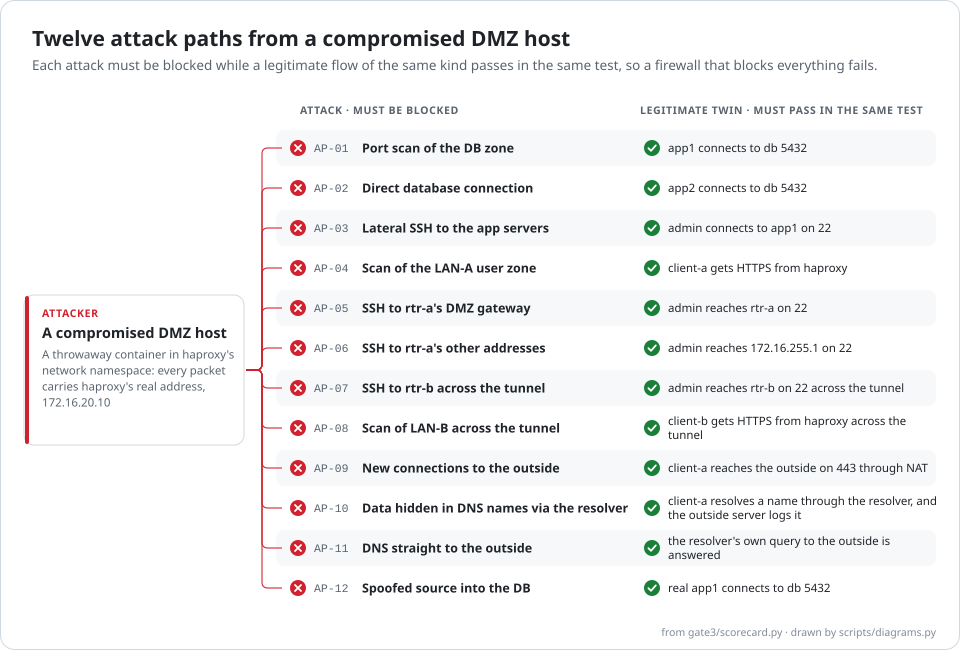
  </picture>
</p>

### 7. From merge to production

<p align="center">
  <picture>
    <source media="(prefers-color-scheme: dark)" srcset="docs/images/supply-chain-dark.svg">
    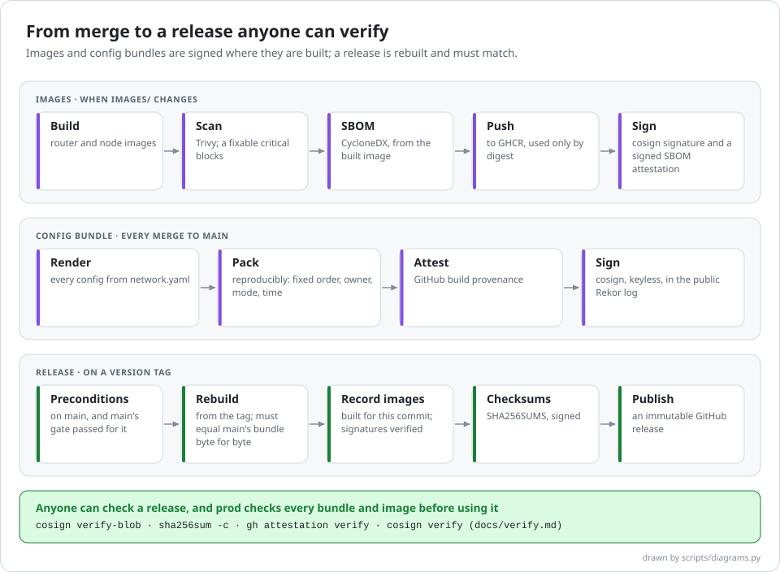
  </picture>
</p>

<p align="center">
  <picture>
    <source media="(prefers-color-scheme: dark)" srcset="docs/images/prod-dark.svg">
    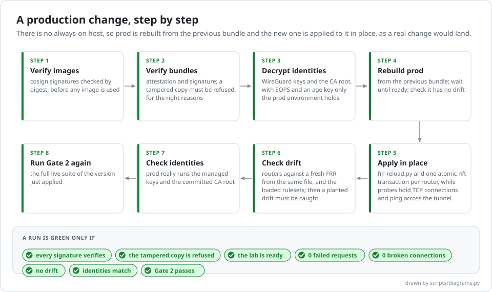
  </picture>
</p>

There is no always-on host, so "prod" is rebuilt in CI from the previous config bundle and the new
one is applied to it in place, as a real change would land. Prod's long-lived WireGuard keys and CA
root are SOPS-encrypted in Git and decrypted only by the `prod` environment
([secrets.md](docs/secrets.md)). Every prod run is in [prod.md](docs/prod.md).

## Why the results can be trusted

- **The method came first.** The grading rules, the 30 faults, the 12 attack paths and the 13
  invariants were committed in [method.md](docs/method.md) before any test existed. Every later rule
  change is a dated amendment.
- **Independent checks.** The invariants and Gate 2's expected values are written by hand and never
  generated from `network.yaml`, so a wrong intent cannot pass both.
- **Every attack has a legitimate twin.** An attack counts as blocked only if a flow that must work
  passes in the same test. A firewall that blocks everything fails.
- **Probes must prove they ran.** A probe that cannot run, a scan that does not finish or a capture
  that never started raises an error instead of reporting "blocked".
- **A broken gate is not a catch.** If a tool or the runner fails in a fault's job, the fault is
  void and re-run, never counted as caught.
- **Escapes and corrections are published.** The three escapes are explained in
  [limits.md](docs/limits.md). An independent review of v1.0.0 found four claims that did not hold;
  they are corrected in public, with the runs that showed them, in
  [review-v1.0.0.md](docs/review-v1.0.0.md).

## Security of the pipeline

- **Pinned and least-privilege.** Every Action is pinned to a commit SHA, and the repository
  refuses unpinned ones. The default workflow token is read-only, and each job asks only for what
  it needs. zizmor and OpenSSF Scorecard audit the workflows; Gitleaks scans the whole history;
  CodeQL scans the code.
- **Signed artifacts, verified before use.** Images are pinned by digest, scanned with Trivy, given
  an SBOM and signed with cosign. Config bundles carry a GitHub artifact attestation and a cosign
  signature, and prod verifies both, and refuses a tampered copy, before applying anything.
- **Reproducible, immutable releases.** A release is rebuilt from its tag and must match main's
  bundle byte for byte. It ships signed checksums and the images' signed SBOMs, release tags are
  protected by a ruleset, and published releases are immutable.
- **Secrets.** Pull-request labs generate WireGuard keys inside their routers, and the keys never
  leave them. Prod's long-lived identities are SOPS-encrypted with age, decrypted only by the `prod`
  environment, checked in use on every prod run, and rotation is proved by a separate test.

The full threat model, with the test behind each control, is in
[threat-model.md](docs/threat-model.md).

## Technology

| Area | Tools |
|---|---|
| Network | FRR 10.7 (BGP), nftables, WireGuard, containerlab 0.83 |
| Services | Unbound, NSD, step-ca (ACME), HAProxy, Prometheus, blackbox_exporter, Grafana |
| Verification | JSON Schema, Open Policy Agent with Conftest, Batfish, `vtysh --dryrun`, pytest, nmap, tcpdump |
| Supply chain | cosign, GitHub artifact attestations, Trivy, CycloneDX SBOMs, SOPS with age |
| Pipeline security | zizmor, Gitleaks, CodeQL, OpenSSF Scorecard, Dependabot |
| Platform | GitHub Actions on free runners, GitHub Container Registry, GitHub Pages |

## Quick start

The lab needs Linux, because the routers are privileged containers running kernel WireGuard. You
need Docker, [containerlab](https://containerlab.dev/) and sudo. The same `make` targets run
locally and in CI:

```bash
make venv              # Python dependencies, from hash-locked files
make images            # build the router and node images
make test              # Gate 2: render, deploy, run the live tests, collect evidence, destroy
make test FAULT=F08    # the same, with one planted fault
```

No containers are needed for `make unit` (the generator, grading and diagram unit tests) or for
`python -m packetproof render --out build/lab`, which renders every config for inspection and needs
only Python. Gate 1 (`make gate1`) also needs a running Batfish container, as
[pr-gate.yml](.github/workflows/pr-gate.yml) shows.

## Repository layout

```text
network.yaml           the intent: sites, zones, hosts, flows, NAT, DNS, PKI, proxy, monitoring
schema/                its JSON Schema
packetproof/           the generator: renders every config and the containerlab topology
policy/intent/         hand-written invariants on network.yaml (Rego, run by Conftest)
policy/rendered/       hand-written checks of each loaded nftables ruleset (Rego)
tests/unit/            generator, grading and diagram unit tests
tests/live/            Gate 2: the live tests and their hand-written expectations
faults/faults.yaml     the 30 planted faults Gate 3 grades the gates with
gate3/                 Gate 3: recording what each gate said, and grading it
scripts/               Gate 1, the prod change, the change plan, SOPS rotation, the diagrams
images/                the router and node container images
feasibility/           the checks that proved free runners could carry the project, before it was built
secrets/               prod's identities, SOPS-encrypted, and their public halves
docs/                  method, results, limits, threat model, walkthroughs, release notes
.github/workflows/     every pipeline: gates, grading, images, bundle, release, prod, security
```

## Documentation

| Document | What it covers |
|---|---|
| [method.md](docs/method.md) | The rules, faults, attack paths and invariants, committed before any test |
| [scorecard.md](docs/scorecard.md) | Every Gate 3 run, and how each fault was graded |
| [limits.md](docs/limits.md) | What each gate cannot see, and why each escape changed no traffic |
| [threat-model.md](docs/threat-model.md) | Each threat, its control, and the test that proves the control |
| [address-plan.md](docs/address-plan.md) | Addressing and routing design |
| [prod.md](docs/prod.md) | The production change path, and every prod run |
| [secrets.md](docs/secrets.md) | Prod's identities and how they are rotated |
| [verify.md](docs/verify.md) | How to verify a release yourself |
| [concepts.md](docs/concepts.md) | Each concept, where it is built and proved, and its nearest cloud equivalent |
| [why.md](docs/why.md) | The design decisions and the sources behind them |
| [feasibility.md](docs/feasibility.md) | The checks that proved free runners could carry the project, before it was built |
| [review-v1.0.0.md](docs/review-v1.0.0.md) | What an independent review of v1.0.0 found, and the fixes |
| [diagnoses/](docs/diagnoses) | Five troubleshooting walkthroughs, from symptom to root cause, with real output |
| [releases/](docs/releases) | Release notes |

The five walkthroughs start from a symptom and work up the stack:
[BGP is up, but site B is unreachable](docs/diagnoses/01-bgp-up-site-unreachable.md) ·
[the frontend cannot reach the API](docs/diagnoses/02-frontend-cannot-reach-api.md) ·
[a stale DNS record took TLS down with it](docs/diagnoses/03-stale-dns-broke-tls.md) ·
[which certificate error is this, and why?](docs/diagnoses/04-which-certificate-error.md) ·
[users lost the internet, and DNS for internet names went with it](docs/diagnoses/05-users-lost-the-internet.md).

## Engineering notes: what the checks caught along the way

Each of these was found by a check, fixed in a commit that says what it saw, and left in the
history:

- **A host's AppArmor follows binaries into containers.** `wg` could not read its key until the key
  moved to `/etc/wireguard`: the runner's profile for `wg` confines it even in a privileged
  container ([feasibility.md](docs/feasibility.md)).
- **A green check that did not pass, twice.** The feasibility verdict step and the SOPS rotation
  test piped their result into `tee` without `pipefail`, so they exited 0 on failure.
- **Probes that could not run made attacks look blocked.** Every probe now has to prove it ran.
- **A datacenter profile switched off a safety net.** `frr defaults datacenter` disables RFC 8212's
  `ebgp-requires-policy`, which is why one fault first escaped ([limits.md](docs/limits.md)).
- **An MTU mismatch is a black hole, not a bottleneck.** The first fix for a path-MTU blind spot
  lowered one end of a link and silently dropped TLS ClientHellos.
- **A pipe added a byte-order mark to a secret.** Piping the age key into `gh secret set` from
  Windows PowerShell 5.1 prefixed it with a UTF-8 BOM, and SOPS rejected it in prod
  ([prod.md](docs/prod.md#prod-with-long-lived-identities-from-sops)).
- **Reproducible archives can break servers.** Bundles packed with every file's time set to 0
  deployed an NSD that never loaded its zone ([prod.md](docs/prod.md)).
- **The apply tool drifted, because of an FRR bug.** Under the datacenter profile, `frr-reload.py`
  switched off `bgp deterministic-med` on an unchanged config. The drift check caught it; the cause
  is FRRouting/frr#22939, fixed upstream but in no release yet. The traditional profile avoids it
  ([prod.md](docs/prod.md#what-the-drift-check-found-an-frr-bug-now-avoided)).
- **A review after release found four claims that did not hold.** Every container also sat on
  containerlab's management network, a path around the firewall; the ISP filter missed more specific
  private routes; three attack-path scans never finished a host; and the drift check could not see
  firewall drift on one router. All four are fixed in v1.1.0 ([review-v1.0.0.md](docs/review-v1.0.0.md)).

## Limitations

- Three faults escape both gates. Each is latent, and each is explained in
  [limits.md](docs/limits.md), with what every gate cannot see.
- Everything runs in containers on shared runners: no real hardware, latency or loss, and the runner
  itself is trusted.
- No change between two different router configs has been measured in prod since v1.1.0 moved every
  host off containerlab's management network; the measured changes ran on the earlier design.
- FRR runs its `traditional` profile to avoid FRRouting/frr#22939 until a release includes the fix.
- Some OpenSSF Scorecard checks stay low for reasons that cannot honestly be fixed yet, such as a
  single maintainer ([threat-model.md](docs/threat-model.md)).

## License

[Apache-2.0](LICENSE)
